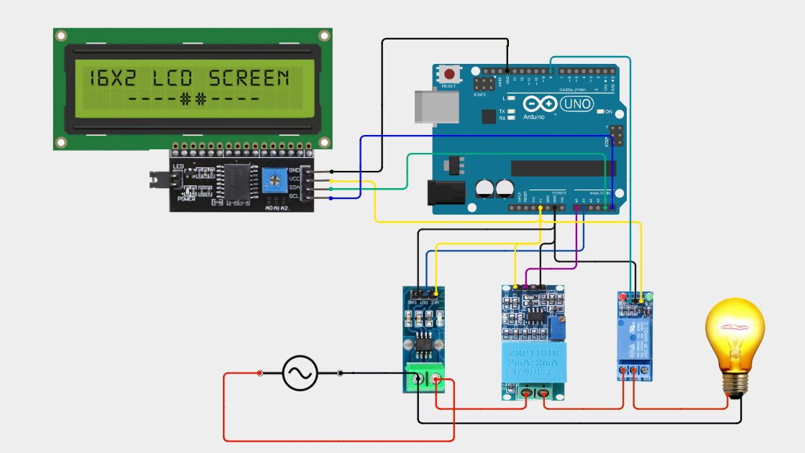

# Energy Meter with Automatic High-Current Cutoff

An energy meter that measures AC voltage and current and disconnects the load when power exceeds 200 W.

## Overview

This project uses a ZMPT101B voltage sensor and an ACS712 current sensor to measure an AC supply. An Arduino Uno reads the sensors, displays the readings on a 16×2 LCD, and controls a relay. When the measured power exceeds 200 W, the relay disconnects the load.

## Key Features

- Measures AC voltage and current
- Displays readings on a 16×2 LCD
- Disconnects the load when power exceeds 200 W
- Project photo: `IMG_0070.JPG`

## System Design

The ZMPT101B and ACS712 send measurement signals to the Arduino Uno. The Arduino processes the readings and displays them on the LCD. If the measured power exceeds 200 W, it switches the relay to disconnect the load.

## Hardware Components

| Component | Part / Value | Purpose |
| --- | --- | --- |
| Microcontroller | Arduino Uno | Reads sensors, updates the LCD, and controls the relay |
| Voltage sensor | ZMPT101B | Measures AC voltage |
| Current sensor | ACS712 | Measures current |
| Relay | 5 V relay | Disconnects the load |
| Display | 16×2 LCD | Shows measurements and status |

## Circuit Diagram

## Software and Tools

- Programming language: Arduino C/C++
- IDE: Arduino IDE
- Hardware tools: [Add any tools you used, or remove this line]

## Results

The relay disconnects the load when the measured power exceeds 200 W.

## How to Build and Run

1. Assemble the components using `circuit.png`.
2. Open `energy_meter.ino` in the Arduino IDE.
3. Set the sensor calibration values and 200 W cutoff in the code.
4. Upload the code to the Arduino Uno.
5. Check the LCD readings and relay cutoff behavior using a safely controlled test setup.

## Limitations and Future Improvements

- Sensor readings depend on calibration.
- This prototype is not a certified electrical protection device.
- Future improvements could include storing energy usage data or adding remote monitoring.

## Team and Contributions

- Meenakshi Sundaram — designed and built the project independently.
